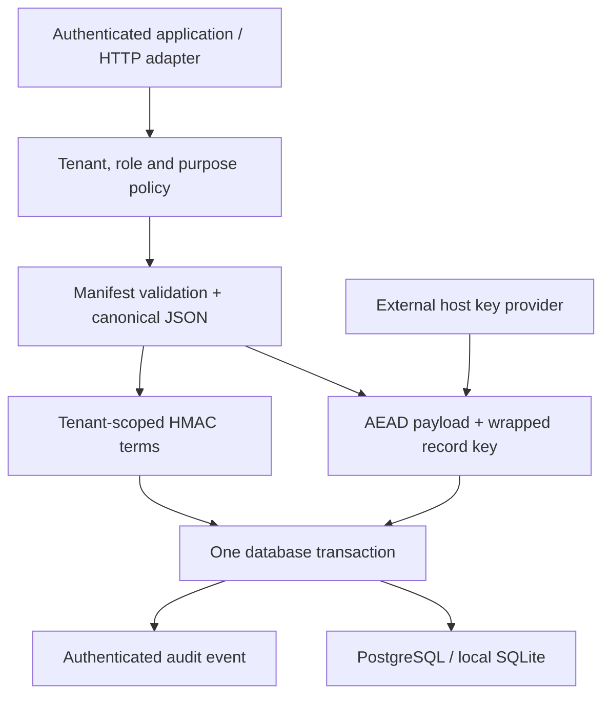

# Architecture

The public API is an explicit document repository, not transparent ORM interception.
The application may use SQLAlchemy models for its ordinary tables alongside Vault.
All AegisVault tables are managed by SQLAlchemy Core and work with the selected dialects.

`av_contracts` binds each project to one manifest fingerprint. It refuses changed contracts;
there is no automatic manifest evolution. The fingerprint also participates in encryption
AAD, so a database cannot authorize a changed document interpretation.

`av_records` stores the encrypted document, wrapped record key, wrapping generation and
optimistic revision. Primary keys include project, tenant, collection and record ID.
`av_terms` stores only exact-search HMAC terms and identifiers. Replacing a document
replaces its terms within the same transaction. Search retrieves and authenticates at most
limit + 1 records, verifies candidate semantics, and paginates by record ID.

`av_events` and `av_audit_heads` implement tenant-scoped authenticated event sequences.
PostgreSQL locks the head row; the compare-and-swap and sequence uniqueness checks also
reject stale writers. Concurrent first-use head creation may return a retryable
`revision_conflict`. SQLite is a development dialect with more restrictive write concurrency.

Returned plaintext is released only after the corresponding audit transaction commits.
Encrypted writes are prepared before the transaction, but no data or index changes survive
if the transaction rolls back. Rotation batches lock selected rows on PostgreSQL and use
revision/wrapped-key comparisons to reject competing updates.

Each process receives key custody from the host. There is no mandatory proxy, stored key
root, autonomous key deletion, or claim of cloud provider qualification.
